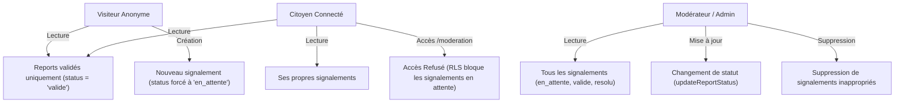

# Rezo Ayiti 🇭🇹

> Plateforme citoyenne et open-source de signalement, cartographie et modération collaborative des infrastructures et services publics en Haïti.

[](LICENSE)
[-black.svg)](https://nextjs.org/)
[](https://www.typescriptlang.org/)
[](https://tailwindcss.com/)
[](https://leafletjs.com/)
[](https://supabase.com/)

---

## 📌 Présentation

**Rezo Ayiti** permet aux citoyens haïtiens, aux collectivités locales et aux décideurs publics de cartographier, signaler et suivre l'état des infrastructures critiques à travers le pays :
- 💧 **Eau** : coupures, fuites sur conduites principales, bornes-fontaines en panne.
- ⚡ **Électricité** : transformateurs endommagés, câbles à terre, coupures prolongées de secteur.
- 🛣️ **Route & Infrastructure** : chaussées dégradées, nids-de-poule dangereux, éboulements, ponts impraticables.
- 🏥 **Santé & Urgence** : dispensaires fermés, ruptures d'approvisionnement en intrants, urgences sanitaires.

Conçue avec une approche **mobile-first**, l'interface s'adapte parfaitement aux smartphones et fonctionne sur des débits réseau réduits.

---

## ✨ Fonctionnalités Principales

### 1. Cartographie Interactive Directe (Leaflet & OpenStreetMap)
- Vue initiale centrée sur l'ensemble d'Haïti (`[18.9712, -72.2852]`, zoom 8).
- Marqueurs dynamiques vectoriels (`L.divIcon`) personnalisés par catégorie d'infrastructure.
- Popups sécurisés contre les failles d'injection HTML/XSS (construction via les APIs DOM standards).
- Navigation fluide sans réinitialisation de la vue lors des mises à jour des données.

### 2. Signalement Citoyen Géolocalisé au Clic
- Sélection des coordonnées GPS en cliquant directement sur la carte (curseur en croix `crosshair`).
- Marqueur temporaire distinctif avec animation de pulsation (`animate-ping`).
- Validation stricte côté client avec Zod sur la boîte englobante d'Haïti :
  - **Latitude** : de `17.9` à `20.2`
  - **Longitude** : de `-74.6` à `-71.6`
- Protection contre les clics hors frontières avec retour visuel immédiat.
- Formulaire complet accessible (titre, catégorie, description avec compteur de caractères, position).

### 3. Liste Publique des Signalements (Lecture Seule)
- Composant dédié [`ReportCard`](components/ReportCard.tsx) affichant les signalements publics validés.
- Badges de catégorie et de statut (*Eau*, *Électricité*, *Route*, *Santé* ; *En attente*, *Validé*, *Résolu*).
- Dates formatées en français (`fr-FR`) et coordonnées GPS.
- Compteur honnête de signalements visibles sans prétention de temps réel non garanti.

### 4. Espace de Modération Sécurisé (`/moderation`)
- Authentification native Supabase Auth (email / mot de passe).
- **Contrôle d'accès strict par rôle** :
  - Utilisateur non connecté : formulaire d'authentification.
  - Rôle `citoyen` : écran de refus formel (*« Accès réservé aux modérateurs »*), aucune donnée de signalement chargée ni affichée.
  - Rôles `moderateur` ou `admin` : tableau de bord de modération avec compteurs par statut (*Total*, *En attente*, *Validé*, *Résolu*), filtres croisés et sélecteur de statut inline par ligne.
- Sécurité garantie au niveau de la base de données via **Row Level Security (RLS)** : le changement de statut est impossible pour un utilisateur non autorisé, même en manipulant l'API.

---

## 🛠️ Stack Technique

| Domaine | Technologies |
| :--- | :--- |
| **Framework Full-Stack** | Next.js 16 (App Router, Turbopack, React 19) |
| **Langage & Typage** | TypeScript (mode strict, typage unifié dans `types/`) |
| **Style & Responsive** | Tailwind CSS 4 (utilitaires modernes, mobile-first) |
| **Cartographie** | Leaflet 1.9.4 (intégration directe sans wrapper lourd, tuiles OpenStreetMap) |
| **Base de Données & Auth** | Supabase (PostgreSQL 15+, extension géospatiale PostGIS) |
| **Validation des données** | Zod 4 (schémas stricts pour signalements et profils) |
| **Sécurité Base** | PostgreSQL Row Level Security (RLS) & Triggers PL/pgSQL |

---

## 📁 Architecture des Dossiers

```text
rezo-ayiti/
├── app/                          # Routes Next.js App Router
│   ├── api/                      # Endpoints REST (CRUD reports, nearby, users)
│   ├── moderation/               # Espace réservé de modération (/moderation)
│   │   └── page.tsx              # Tableau de bord protégé
│   ├── globals.css               # Feuilles de style Tailwind CSS
│   ├── layout.tsx                # Structure HTML globale et métadonnées
│   └── page.tsx                  # Page d'accueil publique (carte + formulaire + liste)
├── components/                   # Composants React réutilisables
│   ├── MapComponent.tsx          # Carte Leaflet interactive (marqueurs, clics, sélection)
│   ├── ModerationList.tsx        # Tableau de bord et filtres de modération
│   └── ReportCard.tsx            # Carte de signalement publique (lecture seule, anti-XSS)
├── docs/                         # Documentation technique et tests
│   ├── API.md                    # Spécification détaillée des endpoints REST
│   └── TESTING.md                # Checklist exhaustive des tests manuels
├── lib/                          # Clients et utilitaires
│   ├── supabase.ts               # Client Supabase public (@supabase/supabase-js)
│   ├── supabase-server.ts        # Client Supabase côté serveur avec token Bearer
│   └── validations.ts            # Schémas de validation Zod et boîte englobante Haïti
├── services/                     # Couche de services centralisée
│   ├── authService.ts            # Authentification (signIn, signOut, getCurrentProfile)
│   └── reportService.ts          # Requêtes reports (get, create, updateReportStatus)
├── supabase/                     # Migrations PostgreSQL et politiques RLS
│   └── migrations/
│       ├── 001_init_reports.sql  # Extension PostGIS et table reports initiale
│       └── 002_profiles_rls_geo.sql # Table profiles, rôles, RLS et fonction PostGIS
├── types/                        # Définitions TypeScript centralisées
│   ├── api.ts                    # Réponses standardisées d'API
│   ├── index.ts                  # Point d'entrée des exports de types
│   ├── profile.ts                # Profils et rôles (citoyen, moderateur, admin)
│   └── report.ts                 # Signalements et paramètres d'entrée
├── .env.example                  # Modèle des variables d'environnement
├── LICENSE                       # Licence open-source MIT
└── package.json                  # Dépendances et scripts de build
```

---

## ⚙️ Installation et Démarrage Local

### 1. Prérequis
- [Node.js](https://nodejs.org/) v20+ ou v22+
- [Git](https://git-scm.com/)
- Un projet [Supabase](https://supabase.com/) actif

### 2. Cloner le dépôt
```bash
git clone https://github.com/GuerrierRuben/rezo-haiti.git
cd rezo-haiti
```

### 3. Installer les dépendances
```bash
npm install
```

### 4. Configurer les variables d'environnement
Créez un fichier `.env.local` à la racine à partir du modèle fourni :
```bash
cp .env.example .env.local
```

Renseignez les deux variables obligatoires fournies dans les paramètres de votre projet Supabase (**Settings > API**) :
```env
NEXT_PUBLIC_SUPABASE_URL=https://votre-projet.supabase.co
NEXT_PUBLIC_SUPABASE_ANON_KEY=votre-cle-anon-publique
```
> [!IMPORTANT]
> Ne renseignez **JAMAIS** la clé `service_role` dans les variables d'environnement du client. L'application s'appuie sur la clé publique `anon` et délègue les autorisations aux politiques de sécurité niveau ligne (RLS) de PostgreSQL.

---

## 🗄️ Exécution des Migrations SQL dans Supabase

Dans l'interface web de votre projet Supabase, ouvrez l'onglet **SQL Editor** et exécutez successivement le contenu des migrations suivantes :

1. **[`supabase/migrations/001_init_reports.sql`](supabase/migrations/001_init_reports.sql)** :
   - Active l'extension `postgis`.
   - Crée la table de base `public.reports`.
   - Définit les contraintes de catégories et de coordonnées géographiques.
2. **[`supabase/migrations/002_profiles_rls_geo.sql`](supabase/migrations/002_profiles_rls_geo.sql)** :
   - Crée la table `public.profiles` liée à `auth.users(id)` avec les rôles (`citoyen`, `moderateur`, `admin`).
   - Installe le trigger automatique de création de profil à l'inscription.
   - Ajoute la colonne spatiale PostGIS calculée `location GEOGRAPHY(Point, 4326)` et l'index GIST.
   - Définit les fonctions de sécurité `is_moderator()` et `is_admin()`.
   - Active le **Row Level Security (RLS)** sur `reports` et `profiles`.
   - Crée la fonction RPC de recherche de proximité `nearby_reports`.

---

## 👤 Création et Promotion d'un Compte Modérateur

Pour des raisons de sécurité, les comptes modérateurs ne peuvent pas s'inscrire librement. Suivez cette procédure en 2 étapes :

### Étape 1 : Créer le compte utilisateur
1. Rendez-vous dans le tableau de bord Supabase : **Authentication > Users**.
2. Cliquez sur **« Add user »** > **« Create user »**.
3. Renseignez l'adresse email (ex: `moderateur@rezoayiti.org`) et un mot de passe sécurisé.
4. Validez : le compte est créé et le trigger SQL lui attribue automatiquement une entrée dans `public.profiles` avec le rôle par défaut `'citoyen'`.

### Étape 2 : Promouvoir en modérateur
Dans l'interface Supabase, deux méthodes sont possibles :
- **Méthode visuelle (Table Editor) :**
  - Ouvrez **Table Editor > profiles**.
  - Localisez la ligne correspondant à l'utilisateur créé.
  - Modifiez la colonne `role` de `citoyen` à `moderateur` (ou `admin`).
- **Méthode SQL (SQL Editor) :**
  ```sql
  UPDATE public.profiles
  SET role = 'moderateur'
  WHERE id = (
      SELECT id FROM auth.users WHERE email = 'moderateur@rezoayiti.org'
  );
  ```

L'utilisateur peut maintenant se connecter sur [http://localhost:3000/moderation](http://localhost:3000/moderation).

---

## 🔒 Modèle de Sécurité (PostgreSQL RLS)

La sécurité de la plateforme ne dépend pas uniquement de l'interface utilisateur ; elle est garantie directement au niveau du moteur PostgreSQL :



- **Table `reports`** :
  - **SELECT** : Accessible publiquement si `status = 'valide'`, à l'auteur pour ses propres signalements, ou à tout modérateur (`is_moderator()`).
  - **INSERT** : Autorisé à tous les utilisateurs (anonymes ou connectés), avec forçage obligatoire du statut à `'en_attente'`.
  - **UPDATE / DELETE** : Strictement réservé aux comptes dont le profil possède le rôle `moderateur` ou `admin`.
- **Table `profiles`** :
  - **SELECT** : Chaque utilisateur ne peut consulter que son propre profil, sauf les administrateurs.
  - **UPDATE** : Un utilisateur peut mettre à jour son nom d'affichage, mais une politique RLS lui interdit de modifier son propre rôle.

---

## 🚦 Feuille de Route et Limites Connues

### Réalisé
- [x] Initialisation Next.js 16 + TypeScript + Tailwind CSS 4.
- [x] Architecture modulaire de types (`types/`) et services centralisés (`services/`).
- [x] API REST complète (`/api/reports`, `/api/reports/nearby`, `/api/users/me`).
- [x] Intégration cartographique Leaflet sans SSR avec marqueurs par catégorie.
- [x] Sélection interactive des coordonnées GPS par clic sur la carte.
- [x] Validation Zod stricte sur les limites géographiques d'Haïti.
- [x] Liste publique en lecture seule (`ReportCard`) avec protection anti-XSS.
- [x] Espace de modération protégé (`/moderation`) avec filtres et compteurs par statut.

### Limites Connues & Améliorations Futures
- **Téléversement de photos** : L'ajout de photographies de terrain via Supabase Storage est prévu dans une version ultérieure.
- **Support hors-ligne avancé** : Fonctionnement en mode dégradé avec synchronisation locale IndexedDB (PWA) lors des coupures de réseau prolongées.
- **Clustering de marqueurs** : Intégration d'un algorithme de regroupement des marqueurs en cas de forte densité sur une même zone urbaine.

---

## 🧪 Tests et Validation

Pour exécuter la checklist complète des scénarios manuels (publication, refus citoyen, modération, tests de robustesse XSS) :
👉 [**Consulter le protocole de test complet (docs/TESTING.md)**](docs/TESTING.md)

Pour lancer la vérification de la compilation et du linter :
```bash
npm run lint
npm run build
```

---

## 🤝 Contribution

Les contributions de la communauté sont encouragées ! Pour participer :
1. Forkez le projet.
2. Créez une branche dédiée (`git checkout -b feature/amelioration-carte`).
3. Appliquez des commits conventionnels et atomiques (`git commit -m 'feat: description claire'`).
4. Vérifiez que `npm run lint` et `npm run build` passent sans erreur.
5. Poussez votre branche et ouvrez une Pull Request.

---

## 📄 Licence

Ce projet est distribué sous licence open-source **MIT**. Consultez le fichier [LICENSE](LICENSE) pour plus de détails.
